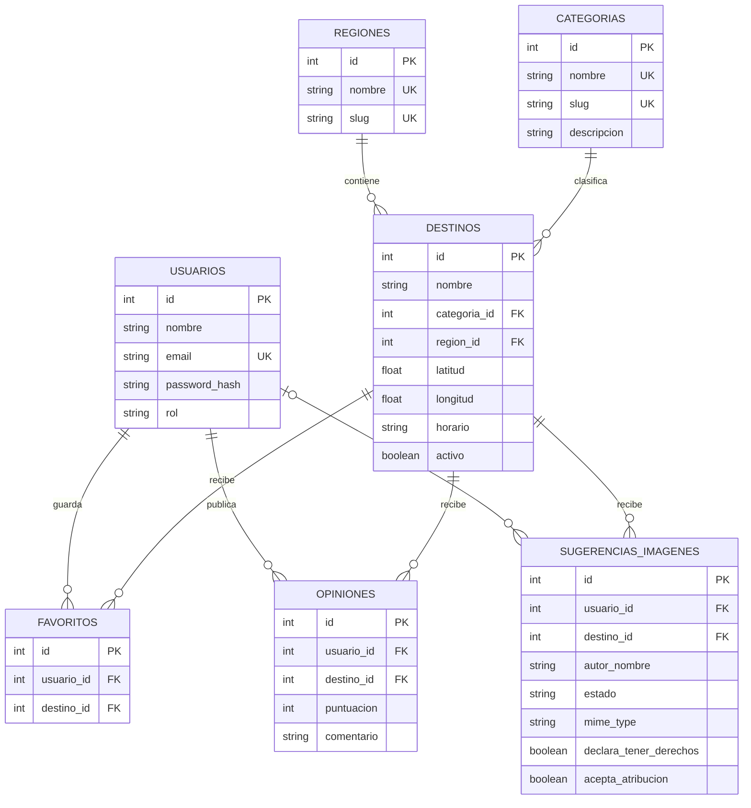

# Sendería Chile — Entrega Parcial 2

**Asignatura:** INF3245-1 — Ingeniería Web y Móvil  
**Entrega:** EP2 — Aplicación turística con frontend, API REST, PostgreSQL y autenticación JWT

Sendería Chile es una aplicación web construida con Ionic y React para explorar destinos turísticos de Chile. Las personas pueden buscar destinos, revisar su información, guardar favoritos y compartir calificaciones y reseñas; el equipo administrador puede mantener el catálogo desde un panel conectado al backend y PostgreSQL.

> Este README describe el estado documentado del proyecto. Las capturas y reportes enlazados muestran ejecuciones concretas; no representan una calificación ni reemplazan la revisión funcional de la versión que se entregue.

## 1. Descripción y alcance

### Funcionalidades del proyecto

| Funcionalidad | Componente o ruta | Estado en esta versión |
|---|---|---|
| Explorar destinos de Chile y buscar por nombre, región o categoría | `frontend/src/pages/Explorar.tsx`, `GET /api/destinos` | Implementada con datos de PostgreSQL |
| Filtrar parques, montañas, desierto y destinos que mencionan reserva | `Explorar.tsx` | Implementada; el filtro de reserva analiza las condiciones de acceso registradas |
| Consultar ficha con descripción, imagen, categoría, región, coordenadas, horario y acceso | `frontend/src/pages/DestinoDetalle.tsx`, `GET /api/destinos/:id` | Implementada cuando esos datos están disponibles |
| Registrar turistas e iniciar/cerrar sesión con correo, contraseña y JWT | `frontend/src/pages/Registro.tsx`, `frontend/src/pages/Login.tsx`, `/api/auth` | Implementada |
| Guardar, consultar y quitar favoritos | `frontend/src/pages/Favoritos.tsx`, `/api/favoritos` | Implementada y asociada al usuario autenticado |
| Crear, editar y quitar destinos desde el panel de administración | `frontend/src/pages/AdminDashboard.tsx`, `/api/destinos` | Implementada; quitar un destino lo oculta y conserva su registro en PostgreSQL |
| Mapa interactivo de destinos | `frontend/src/components/MapaDestinos.tsx`, `Explorar.tsx`, `DestinoDetalle.tsx` | Implementado con Leaflet y teselas de OpenStreetMap; muestra marcadores de destinos activos que tienen coordenadas |
| Inicio de sesión con Google, verificación de correo y recuperación por correo | — | No implementados en esta versión |
| Calificar destinos y publicar una reseña opcional | `frontend/src/components/OpinionesDestino.tsx`, `/api/destinos/:id/opiniones` | Implementado para cuentas autenticadas; los promedios se calculan con opiniones almacenadas en PostgreSQL |
| Sugerir imágenes de destinos | `frontend/src/components/SugerenciasImagenesDestino.tsx`, `/api/destinos/:id/sugerencias-imagenes` | Disponible para cuentas autenticadas; las imágenes quedan privadas hasta que un administrador las aprueba y luego muestran el nombre de quien las aportó |

El catálogo que muestra la aplicación proviene de PostgreSQL y se carga mediante la API propia. `backend/src/db/seed.sql` carga datos iniciales de muestra. `backend/src/db/sernatur_carga_unica.sql` es una carga ampliada opcional con el catálogo SERNATUR y propuestas de enriquecimiento; se ejecuta por separado y no forma parte de la inicialización normal. La aplicación todavía no completa automáticamente fichas desde SERNATUR o Wikipedia. Geoapify puede resolver coordenadas cuando el administrador crea un destino sin ingresarlas, si está configurada `GEOAPIFY_API_KEY`.

## 2. Equipo, repositorio y trazabilidad

**Nombre del equipo:** Sendería Chile  
**Repositorio:** [github.com/ItsRigozzi/Senderia-Chile---Turismo](https://github.com/ItsRigozzi/Senderia-Chile---Turismo)  
**Rama principal:** [`main`](https://github.com/ItsRigozzi/Senderia-Chile---Turismo/tree/main)  
**Rama frontend:** [`frontend`](https://github.com/ItsRigozzi/Senderia-Chile---Turismo/tree/frontend)  
**Rama backend:** [`backend`](https://github.com/ItsRigozzi/Senderia-Chile---Turismo/tree/backend)  
**Prototipo Figma de EP1:** [Sendería Chile — Prototipo UI/UX](https://www.figma.com/design/yRcGT1RLb30dPo94QykQva/Senderia-chile?node-id=0-1&t=yAZn8pyTL7C6l2ac-1). El acceso debe permitir que el equipo docente lo revise.

**Integrantes registrados en EP1:** Rigoberto Canales, Benjamín Pizarro, Joaquín Muñoz y Simón Vera. Los cuatro integrantes participaron colaborativamente en el desarrollo del proyecto.

### Relación de los requerimientos funcionales de EP1 con esta versión

| ID EP1 | Funcionalidad | Implementación actual |
|---|---|---|
| RF-01 | Explorar destinos en un mapa interactivo con marcadores | Implementado con Leaflet y teselas de OpenStreetMap. En EP1 se propuso Google Maps; la tecnología del mapa cambió, manteniendo la exploración geográfica. |
| RF-02 | Buscar y filtrar por categoría y región | Implementado en Explorar mediante búsqueda y filtros disponibles. |
| RF-03 | Consultar la ficha de un destino con datos prácticos y ubicación | Implementado en la vista de detalle; el mapa aparece cuando hay coordenadas válidas. |
| RF-04 | Crear, consultar, modificar y eliminar destinos | CRUD disponible en el panel admin. La imagen se ingresa mediante URL; eliminar oculta el destino y conserva el registro en la base de datos. |
| RF-05 | Clasificar destinos por categoría, región y tipo | Categoría y región se asignan desde el formulario de destinos. |
| RF-06 | Administrar categorías | La API permite operaciones CRUD de categorías; no hay una pantalla del panel admin para gestionarlas en esta versión. |
| RF-07 | Administrar cuentas y roles | La API admin permite listar, editar nombre o rol y eliminar usuarios; no hay una pantalla de gestión de usuarios ni un campo de estado en el panel. |
| RF-08 | Guardar y administrar destinos favoritos | Implementado para turistas autenticados mediante la API y la vista Favoritos. |

| ID EP1 | Funcionalidad transversal | Implementación actual |
|---|---|---|
| FT-01 | Registrar usuarios | El turista se registra desde la interfaz; la cuenta admin se crea mediante un comando de backend. |
| FT-02 | Iniciar sesión | Implementado con correo y contraseña. |
| FT-03 | Cerrar sesión | Implementado desde la interfaz. |
| FT-04 | Restringir acciones por rol | Implementado con rutas protegidas y validación de roles en el backend. |
| FT-05 | Explorar como invitado | El catálogo y las fichas son públicos; favoritos requiere iniciar sesión. |

**Nota de trazabilidad:** el README de EP1 dice que hay siete requerimientos funcionales principales, pero su tabla enumera ocho (RF-01 a RF-08). Esta documentación conserva los ocho identificadores tal como aparecen en esa tabla.

## 3. Tecnologías

| Capa | Tecnología |
|---|---|
| Frontend | Ionic React, React 19, TypeScript, Vite y Capacitor |
| Backend | Node.js, Express y TypeScript |
| Base de datos | PostgreSQL; acceso mediante `pg` |
| Autenticación y autorización | JWT, `bcryptjs`, middleware de autenticación y roles `turista` / `admin` |
| Mapa y cartografía | Leaflet, React Leaflet y teselas de OpenStreetMap |
| Geocodificación de destinos | Geoapify opcional para buscar coordenadas faltantes desde el panel admin |
| Validación y comunicación | Zod, Axios, API REST y JSON |
| Pruebas | Node.js Test Runner, Vitest, Cypress y Postman |

Las versiones detalladas están declaradas en `frontend/package.json` y `backend/package.json`. Para la ejecución documentada se requiere Node.js 22.12 o posterior y PostgreSQL 14 o posterior.

## 4. Arquitectura y estructura del proyecto

```text
Senderia-Chile---Turismo/
├── README.md
├── evidencia/
│   ├── auditoria-imagenes/
│   └── recorrido-integrado/
├── backend/
│   ├── scripts/                 # Inicialización de PostgreSQL
│   ├── uploads/                  # Imágenes sugeridas guardadas localmente; excluidas de Git
│   ├── src/
│   │   ├── config/              # Conexión a PostgreSQL
│   │   ├── controllers/         # HTTP y respuestas
│   │   ├── db/                  # SQL del flujo principal
│   │   │   ├── init.sql
│   │   │   ├── seed.sql
│   │   │   └── sernatur_carga_unica.sql  # Carga ampliada opcional
│   │   ├── middleware/          # JWT y roles
│   │   ├── routes/              # Rutas REST
│   │   ├── services/            # Consultas y reglas de negocio
│   │   └── validators/          # Esquemas Zod
│   ├── test/                    # Pruebas backend e integración
│   └── postman/                 # Colección y evidencia API
└── frontend/
    ├── cypress/                 # Pruebas de interfaz
    ├── public/images/destinos/  # Imágenes y créditos
    └── src/
        ├── components/
        ├── context/             # Estado de autenticación
        ├── pages/               # Explorar, detalle, favoritos y admin
        ├── routes/              # Protección de rutas
        └── services/            # Cliente Axios para la API
```

```text
Ionic + React
     │ Axios / JSON / JWT
     ▼
Express :3000 → rutas → controladores → servicios → PostgreSQL
                  │                         │
                  └── middleware JWT/roles ─┘
```

El backend es la autoridad para autenticar usuarios y verificar roles. El frontend consume sus endpoints; las consultas y escrituras persistentes se realizan en PostgreSQL.

## 5. Preparación y ejecución local

### Requisitos

- Windows y PowerShell (los comandos de esta guía usan `npm.cmd`).
- Node.js 22.12 o posterior y npm ([descarga oficial](https://nodejs.org/en/download/)).
- PostgreSQL 14 o posterior ([instalador para Windows](https://www.postgresql.org/download/windows/)).
- Ionic CLI es opcional: se puede iniciar el frontend con Vite sin instalarlo globalmente.

### 5.1 Obtener el proyecto e iniciar PostgreSQL

Clona el repositorio y entra a la rama principal:

```powershell
git clone https://github.com/ItsRigozzi/Senderia-Chile---Turismo.git
cd .\Senderia-Chile---Turismo
```

Inicia el servicio PostgreSQL desde Windows: pulsa **Win + R**, escribe `services.msc`, busca el servicio de la versión instalada (por ejemplo, `postgresql-x64-18`) y selecciona **Iniciar** si está detenido. Después abre pgAdmin, expande **Servers** y conéctate a esa misma instalación. pgAdmin administra la conexión y las bases de datos; el servicio PostgreSQL debe estar iniciado para que la aplicación se conecte.

En pgAdmin, expande el servidor y revisa **Properties → Connection → Port**. En esta guía se usa `5432`. Si la base `senderia` todavía no existe, créala con clic derecho en **Databases → Create → Database**, con nombre `senderia` y el usuario propietario que usarás en el backend (normalmente `postgres`). El script `init-db.ps1` también la crea automáticamente si no existe.

El puerto del servidor PostgreSQL debe coincidir con `DB_PORT` de `backend/.env`. No lo confundas con el puerto de la API (`3000`) ni con el del frontend Vite (normalmente `5173`).

### 5.2 Configurar el backend

Desde la raíz del repositorio, crea `backend/.env` solo si todavía no existe y edítalo:

```powershell
if (-not (Test-Path .\backend\.env)) { Copy-Item .\backend\.env.example .\backend\.env }
notepad .\backend\.env
```

Configura la conexión con los datos de tu PostgreSQL:

```env
PORT=3000
DB_HOST=localhost
DB_PORT=5432
DB_NAME=senderia
DB_USER=postgres
DB_PASSWORD=tu_contraseña_local_de_postgresql
JWT_SECRET=un_secreto_aleatorio_de_al_menos_32_caracteres
DB_SSL=false
```

Si pgAdmin muestra otro puerto, usa ese mismo valor en `DB_PORT`. También puedes generar el secreto JWT desde PowerShell:

```powershell
node -e "console.log(require('crypto').randomBytes(32).toString('hex'))"
```

Copia el resultado en `JWT_SECRET`. No compartas `backend/.env` ni copies el `.env.example` encima de un archivo local que ya esté configurado.

### 5.3 Crear el esquema y cargar los datos iniciales

Desde la raíz del repositorio:

```powershell
powershell.exe -NoProfile -ExecutionPolicy Bypass -File .\backend\scripts\init-db.ps1
```

El script lee `backend/.env`, comprueba la conexión, crea la base si falta y ejecuta `backend/src/db/init.sql` y `backend/src/db/seed.sql`. El esquema prepara las tablas; el seed carga regiones, categorías y destinos de muestra. La inicialización puede repetirse y no elimina toda la base de datos.

Si ya tienes la base creada y actualizaste el proyecto, detén el backend y ejecuta solo `backend/src/db/init.sql` desde pgAdmin para crear las tablas nuevas de opiniones e imágenes sugeridas: conéctate a `senderia`, abre **Query Tool**, usa **File → Open File**, selecciona ese archivo y presiona **F5**. Espera a que termine y ejecuta `COMMIT;` en la misma pestaña si pgAdmin dejó una transacción abierta. El script conserva los datos existentes y no vuelve a cargar el seed ni el catálogo SERNATUR. Después, vuelve a iniciar el backend.

### 5.4 Cargar el catálogo SERNATUR ampliado para reproducir los datos de entrega

Después de ejecutar `init-db.ps1`, conéctate en pgAdmin a la base `senderia`, abre **Query Tool**, selecciona **File → Open File**, carga `backend/src/db/sernatur_carga_unica.sql` y presiona **F5** para guardar el catálogo ampliado en PostgreSQL. Espera a que Query Tool confirme que terminó antes de continuar. Esta carga es necesaria para que el profesor vea el catálogo SERNATUR ampliado; si se omite, la aplicación tendrá solo los destinos de muestra incluidos en `seed.sql`.

No hay un comando de `npm` para esta carga: `init-db.ps1` crea la base si hace falta y ejecuta `init.sql` y `seed.sql`; el catálogo ampliado se ejecuta una vez desde pgAdmin. El archivo puede volver a ejecutarse sin duplicar los destinos identificados por código SERNATUR.

`sernatur_carga_unica.sql` integra la carga fuente, la revisión, la promoción de candidatos y las ocultaciones solicitadas; es el único SQL específico de SERNATUR que se debe conservar y ejecutar. El modo opcional `--import-fuente` del script de enriquecimiento reejecuta este archivo integrado si necesita restaurar la fuente.

### 5.5 Instalar dependencias y crear el administrador

Desde la raíz, instala las dependencias del backend y crea o configura la cuenta administradora:

```powershell
cd .\backend
npm.cmd install
$env:ADMIN_NAME = 'Administrador Senderia'
$env:ADMIN_EMAIL = 'admin@senderia.cl'
$env:ADMIN_PASSWORD = 'escribe-una-clave-privada-de-12-caracteres-o-mas'
npm.cmd run admin:create
```

La contraseña del administrador debe tener al menos 12 caracteres. Este comando crea o actualiza esa cuenta; utiliza una contraseña privada y no la guardes en el repositorio.

### 5.6 Iniciar el backend

En una terminal PowerShell, desde `backend/`:

```powershell
npm.cmd run dev
```

La API queda en `http://localhost:3000/api`. El estado del servidor y de PostgreSQL se consulta en `http://localhost:3000/api/health`.

### 5.7 Instalar e iniciar el frontend

Abre una segunda terminal PowerShell desde la raíz:

```powershell
cd .\frontend
if (-not (Test-Path .env.local)) { Copy-Item .env.example .env.local }
npm.cmd install
npm.cmd run dev
```

Abre la dirección que indique Vite, normalmente `http://localhost:5173`. También puedes iniciar el frontend con `ionic.cmd serve` en lugar de `npm.cmd run dev`; no ejecutes ambas opciones al mismo tiempo. La variable `VITE_API_URL` de `frontend/.env.local` debe apuntar a `http://localhost:3000/api` en desarrollo.

### Inicio en sesiones posteriores

Con la base ya inicializada, no repitas `init-db.ps1` ni `admin:create` para cada inicio. Inicia PostgreSQL y deja abiertas dos terminales: una en `backend/` con `npm.cmd run dev` y otra en `frontend/` con `npm.cmd run dev` o `ionic.cmd serve`.

## 6. API REST disponible

**URL base local:** `http://localhost:3000/api`  
**Formato:** JSON  
**Autorización:** `Authorization: Bearer <JWT>` en rutas protegidas.

| Método | Ruta | Acceso | Función |
|---|---|---|---|
| GET | `/health` | Público | Estado de Express y conexión a PostgreSQL |
| POST | `/auth/register` | Público | Registrar una cuenta turista |
| POST | `/auth/login` | Público | Iniciar sesión y recibir JWT |
| GET | `/auth/me` | JWT | Consultar la identidad vigente desde PostgreSQL |
| GET | `/destinos?categoria=<slug>&region=<slug>` | Público | Listar y filtrar destinos activos |
| GET | `/destinos/:id` | Público | Consultar la ficha de un destino activo |
| GET | `/destinos/:id/imagenes-comunidad` | Público | Listar las imágenes aprobadas para un destino |
| GET | `/destinos/:id/imagenes-comunidad/:imagenId/archivo` | Público | Ver una imagen aprobada |
| POST | `/destinos/:id/sugerencias-imagenes` | JWT | Enviar una imagen JPG, PNG o WebP (máximo 5 MB) para revisión |
| GET | `/destinos/:id/opiniones` | Público | Consultar promedio, cantidad de opiniones, nombre público, puntuación y reseña opcional |
| GET | `/destinos/:id/opinion` | JWT | Consultar la opinión propia del usuario autenticado |
| POST | `/destinos/:id/opiniones` | JWT | Crear o actualizar una puntuación de 1 a 5 y una reseña opcional |
| POST | `/destinos` | Admin | Crear un destino |
| PUT | `/destinos/:id` | Admin | Actualizar un destino |
| DELETE | `/destinos/:id` | Admin | Ocultar un destino, conservando su registro en PostgreSQL |
| GET | `/categorias` | Público | Listar categorías |
| GET | `/categorias/regiones` | Público | Listar regiones |
| POST | `/categorias` | Admin | Crear una categoría |
| PUT | `/categorias/:id` | Admin | Actualizar una categoría |
| DELETE | `/categorias/:id` | Admin | Eliminar una categoría sin destinos asociados |
| GET | `/usuarios` | Admin | Listar usuarios sin exponer hashes de contraseña |
| PATCH | `/usuarios/:id` | Admin | Actualizar nombre o rol |
| DELETE | `/usuarios/:id` | Admin | Eliminar un usuario; no permite eliminar la propia cuenta |
| GET | `/favoritos` | JWT | Listar favoritos del usuario autenticado |
| POST | `/favoritos` | JWT | Guardar un destino como favorito |
| DELETE | `/favoritos/:id` | JWT | Quitar un favorito propio |
| GET | `/sugerencias-imagenes` | Admin | Consultar las imágenes pendientes de revisión |
| GET | `/sugerencias-imagenes/:id/archivo` | Admin | Ver una imagen pendiente de forma privada |
| PATCH | `/sugerencias-imagenes/:id/revision` | Admin | Aprobar o rechazar una imagen |

Las rutas públicas de destinos solo devuelven registros activos. La operación `DELETE /destinos/:id` cambia ese estado a inactivo para que el destino deje de aparecer, sin borrar físicamente el registro ni sus datos de respaldo.

El envío usa `multipart/form-data` con los campos `imagen`, `declara_derechos=true`, `acepta_atribucion=true` y `comentario` opcional. Las imágenes pendientes se guardan localmente en `backend/uploads/sugerencias-imagenes/`, carpeta excluida de Git; PostgreSQL guarda el estado, la atribución y la metadata. Solo el endpoint de imágenes aprobadas las entrega al público. La ficha muestra “Imagen aportada por [nombre]”. La atribución deja constancia del origen y de la declaración del usuario; por sí sola no transfiere ni elimina responsabilidades legales. Para reproducir cargas locales en otro computador, se deben copiar también los archivos de esa carpeta.

El formulario presenta dos confirmaciones obligatorias: que la persona tomó la foto o cuenta con permiso para compartirla, y que acepta mostrar su nombre si se publica. El servidor solo acepta archivos JPG, PNG y WebP de hasta 5 MB y comprueba su firma, además del tipo MIME informado por el navegador.

### Ejemplos de solicitudes

**Registro — `POST /auth/register`:**

```json
{
  "nombre": "Turista de prueba",
  "email": "turista@example.com",
  "password": "ClaveDePrueba123"
}
```

**Crear destino — `POST /destinos` (requiere JWT de admin):**

```json
{
  "nombre": "Destino de prueba",
  "descripcion": "Descripción del lugar",
  "categoria_id": 1,
  "region_id": 1,
  "latitud": -33.45,
  "longitud": -70.66,
  "horario": "Acceso libre",
  "condiciones_acceso": "Revisar las condiciones antes de la visita.",
  "imagen_url": "https://example.com/imagen.jpg"
}
```

El registro exitoso responde `201`; los datos inválidos responden `400` y un correo ya registrado `409`. En rutas protegidas, una sesión ausente o inválida responde `401` y un rol insuficiente `403`. Un recurso inexistente responde `404`; un problema de conexión con PostgreSQL puede responder `503`.

## 7. Seguridad y autenticación

| Control | Implementación en Sendería |
|---|---|
| JWT | Token de sesión firmado con `JWT_SECRET`, con expiración de 24 horas |
| Contraseñas | Hash con bcrypt mediante `bcryptjs`; nunca se devuelve el hash en las rutas de usuarios |
| Roles | Roles `turista` y `admin`; el middleware de backend verifica permisos en rutas administrativas |
| Validación | Esquemas Zod para entradas y parámetros; contraseña turista de al menos 8 caracteres con al menos una letra o número; contraseña admin de al menos 12 caracteres |
| SQL | Consultas parametrizadas con PostgreSQL y restricciones de integridad en el esquema |
| Correo | Normalizado a minúsculas y espacios recortados para registro e inicio de sesión |
| Coordenadas | Validación de latitud y longitud en la API y restricciones de rango en PostgreSQL |
| Imágenes aportadas | Solo cuentas autenticadas; JPG, PNG y WebP hasta 5 MB, validación del tipo de archivo y aprobación administrativa antes de publicar |
| Secreto | `JWT_SECRET` se define en el entorno local; el backend no inicia si falta o es un valor de ejemplo débil |
| Destinos | El borrado desde el panel es lógico: se conserva el registro y se excluye del catálogo activo |

El registro/inicio de sesión actual usa correo y contraseña. Google OAuth, confirmación de correo y recuperación de contraseña por correo no forman parte de esta versión. La configuración CORS de desarrollo acepta los orígenes locales `localhost:5173` y `localhost:8100`; se debe adaptar si se despliega la aplicación en otro dominio.

**Dependencias:** la revisión documentada anteriormente registró tres alertas moderadas asociadas a React Router. Esta edición del README no ejecutó una auditoría nueva; revisar el estado actual antes de publicar y evaluar cualquier actualización para mantener compatibilidad con Ionic. No aplicar actualizaciones forzadas sin revisar sus cambios.

## 8. Integración frontend–backend

El frontend realiza solicitudes HTTP con Axios desde `frontend/src/services/api.ts`. La dirección base se configura mediante `VITE_API_URL`. El backend valida los datos, autentica las sesiones, aplica permisos y consulta PostgreSQL; el frontend muestra los resultados y maneja los errores devueltos por la API.

Flujos incluidos:

1. El usuario explora el catálogo que entrega `GET /api/destinos`.
2. Al abrir una ficha, el frontend consulta `GET /api/destinos/:id` y muestra la información guardada junto con un mapa interactivo cuando el destino tiene coordenadas válidas.
3. El registro o inicio de sesión entrega un JWT de Sendería; el frontend lo utiliza en las rutas que requieren autenticación.
4. Los favoritos se consultan y modifican en la API para el usuario autenticado.
5. El panel admin envía altas, cambios y bajas lógicas de destinos a la API; las modificaciones quedan en PostgreSQL.
6. Una persona con sesión puede enviar una imagen; solo el administrador puede aprobarla o rechazarla. Las aprobadas se muestran en la ficha con el nombre de quien la aportó.

El recorrido integrado capturado está en [`evidencia/recorrido-integrado/`](evidencia/recorrido-integrado/). Las pruebas Cypress, en cambio, interceptan respuestas HTTP y no reemplazan la comprobación con el backend y PostgreSQL reales.

## 9. Pruebas y evidencia EP2

### Reporte de Postman guardado

El reporte JSON archivado registra **47 pruebas aprobadas y 0 fallidas** en una ejecución del 15 de octubre de 2026. Antes de la entrega, volver a ejecutar la colección si cambian la API o las solicitudes y actualizar las evidencias con el resultado más reciente.

- Colección: [`backend/postman/Senderia-EP2.postman_collection.json`](backend/postman/Senderia-EP2.postman_collection.json).
- Reporte JSON: [`Senderia Chile - EP2 API.postman_test_run.json`](backend/postman/evidencia/Senderia%20Chile%20-%20EP2%20API.postman_test_run.json).
- Captura de Postman: [`Senderia-EP2-evidencia.png`](backend/postman/evidencia/Senderia-EP2-evidencia.png).
- Captura de integración backend/PostgreSQL: [`Senderia-EP2-test-api-backend.png`](backend/postman/evidencia/Senderia-EP2-test-api-backend.png).

### Ejecutar manualmente la colección Postman

1. En Postman Desktop, importa `backend/postman/Senderia-EP2.postman_collection.json`.
2. Selecciona un Environment local y configura `baseUrl` (`http://localhost:3000/api`), `adminEmail`, `adminPassword` y `turistaPassword`. Usa una contraseña temporal de turista con al menos 8 caracteres y por lo menos una letra o número. El correo de prueba se genera automáticamente.
3. Con PostgreSQL y el backend activos, ejecuta la colección completa en orden y con una iteración. Crea datos temporales para probar autenticación, permisos y operaciones CRUD; al final los elimina. Si una ejecución se interrumpe, revisa la base y elimina manualmente los datos temporales que hayan quedado.
4. No compartas el Environment si contiene contraseñas ni exportes tokens en el reporte.

### Comandos de verificación disponibles

Ejecuta cada comando en su carpeta correspondiente:

| Verificación | Comando | Observación |
|---|---|---|
| Compilación y pruebas de validación backend | `npm.cmd test` en `backend/` | El script compila y ejecuta Node.js Test Runner |
| Integración API/PostgreSQL | `npm.cmd run test:api` en `backend/` | Requiere PostgreSQL, API activa, base y credenciales de admin configuradas |
| Pruebas unitarias frontend | `npm.cmd run test.unit -- --run` en `frontend/` | Vitest |
| Pruebas de interfaz | `npm.cmd run test.e2e` en `frontend/` | Requiere Vite activo en `localhost:5173`; Cypress usa respuestas de API simuladas |
| Lint y compilación frontend | `npm.cmd run lint` y `npm.cmd run build` en `frontend/` | ESLint, TypeScript y Vite |

### Ejecutar la prueba de integración

Desde `backend/`, con PostgreSQL y la API activa en otra terminal, y con un administrador existente:

```powershell
$env:ADMIN_EMAIL = 'admin@senderia.cl'
$env:ADMIN_PASSWORD = 'tu-contraseña-admin-actual'
npm.cmd run test:api
```

La prueba crea registros temporales para revisar autenticación, persistencia, CRUD, permisos y protección de hashes. No incluyas contraseñas ni tokens en evidencias compartidas.

### Evidencia del recorrido integrado

Las capturas están ordenadas en [`evidencia/recorrido-integrado/README.md`](evidencia/recorrido-integrado/README.md): ejecución de servicios, exploración pública, sesión admin, formulario de destinos, registro e inicio de sesión turista, detalle y favoritos. Son evidencia visual del flujo capturado; no sustituyen las pruebas automatizadas.

## 10. Modelo relacional

**Esquema:** [`backend/src/db/init.sql`](backend/src/db/init.sql).  
**Datos iniciales:** [`backend/src/db/seed.sql`](backend/src/db/seed.sql).

El modelo contiene regiones, categorías, usuarios, destinos, favoritos, opiniones y sugerencias de imágenes. Las claves foráneas conectan cada destino con su región y categoría, y favoritos, opiniones e imágenes sugeridas con su usuario y destino. Cada cuenta puede publicar una sola opinión por destino; puede actualizar su puntuación y reseña. Las imágenes conservan una copia del nombre del aportante y el consentimiento declarado, y requieren aprobación administrativa para mostrarse. El correo no se expone. Los destinos incluyen `activo` para conservar los registros quitados del catálogo.



La base impide duplicar el mismo nombre de destino dentro de una región y limita las coordenadas a rangos geográficos válidos. En favoritos y opiniones, la combinación usuario/destino es única; la puntuación se limita a 1–5 estrellas.

## 11. Matriz de cumplimiento EP2

Esta matriz relaciona los componentes del proyecto con los criterios de entrega documentados. **No asigna puntajes ni reemplaza la evaluación del profesor.**

| Criterio | Implementación identificada | Estado/evidencia |
|---|---|---|
| EP 2.1 — Servidor | API modular Express/TypeScript en `backend/src/` | Código y comandos de ejecución documentados |
| EP 2.2 — Base relacional | PostgreSQL, esquema y seed reproducibles | SQL en `backend/src/db/`; inicialización en sección 5 |
| EP 2.3 — API REST | Rutas públicas y protegidas para destinos, categorías, usuarios y favoritos | Endpoints documentados en sección 6; colección Postman adjunta |
| EP 2.4 — JWT y roles | Login, JWT con expiración, middleware y roles `turista` / `admin` | Código en `auth`, `middleware` y rutas protegidas |
| EP 2.5 — Seguridad | bcrypt, Zod, consultas parametrizadas, secreto en entorno y permisos de backend | Implementado en la API; revisar configuración antes de despliegue |
| EP 2.6 — Ionic React y backend | Ionic React consume API REST con Axios | Vistas y servicios en `frontend/src/`; recorrido visual guardado |
| EP 2.7 — Pruebas | Postman, pruebas backend, Vitest y Cypress | Reporte Postman archivado; repetir verificaciones finales tras los cambios |
| Documentación y trazabilidad | README con arquitectura, ejecución, endpoints, modelo, evidencia, requisitos EP1 y Figma | RF-01 a RF-08 relacionados con la implementación; Figma de EP1 enlazado |

## 12. Lista de verificación antes de la entrega

- [x] Documentar cómo configurar PostgreSQL y ejecutar el proyecto en Windows.
- [x] Documentar API, autenticación, roles, modelo SQL y pruebas disponibles.
- [x] Guardar evidencia Postman y capturas del recorrido integrado.
- [x] Asociar las funcionalidades a los identificadores RF-01 a RF-08 definidos en EP1.
- [x] Incorporar el enlace del prototipo Figma de EP1.
- [ ] Ejecutar nuevamente el recorrido integrado con frontend, backend y PostgreSQL después de los últimos cambios.
- [ ] Ejecutar las verificaciones finales y actualizar el reporte/evidencia de Postman si corresponde.
- [ ] Revisar nuevamente las alertas de dependencias antes de publicar.
- [x] Integrar el mapa interactivo con Leaflet y OpenStreetMap en Explorar y en las fichas con coordenadas.
- [ ] Confirmar que el repositorio y la versión en `main` sean accesibles para el profesor y ayudante.
- [ ] Revisar la URL registrada en Aula Virtual y los permisos del repositorio.

El mapa interactivo ya está implementado con Leaflet y OpenStreetMap. El inicio de sesión con Google, la confirmación de correo y la recuperación de contraseña por correo siguen fuera de esta versión y dependen del alcance acordado con el profesor.

## 13. Referencias y recursos del proyecto

- [Ionic React](https://ionicframework.com/docs/react/overview)
- [React](https://react.dev/)
- [Express](https://expressjs.com/)
- [PostgreSQL](https://www.postgresql.org/docs/)
- [JSON Web Tokens](https://jwt.io/introduction)
- [Zod](https://zod.dev/)
- [Postman](https://learning.postman.com/docs/)
- [Cypress](https://docs.cypress.io/)
- Créditos, autoría y licencias de las imágenes locales: [`frontend/public/images/destinos/CREDITOS.md`](frontend/public/images/destinos/CREDITOS.md).
- Créditos, licencias y fuentes de las cuatro imágenes de reemplazo SERNATUR: [`evidencia/auditoria-imagenes/creditos-reemplazos.md`](evidencia/auditoria-imagenes/creditos-reemplazos.md).
- Informe y resultados de la revisión visual del catálogo: [`evidencia/auditoria-imagenes/README.md`](evidencia/auditoria-imagenes/README.md).
