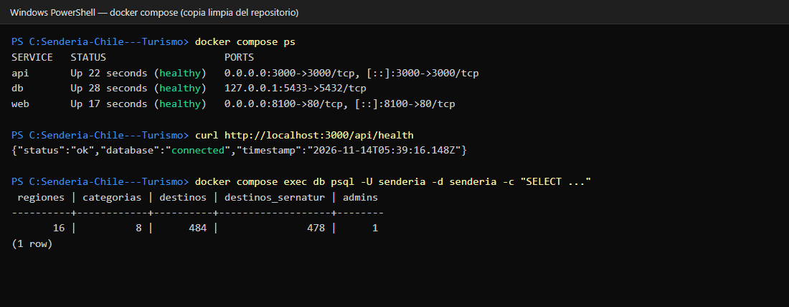
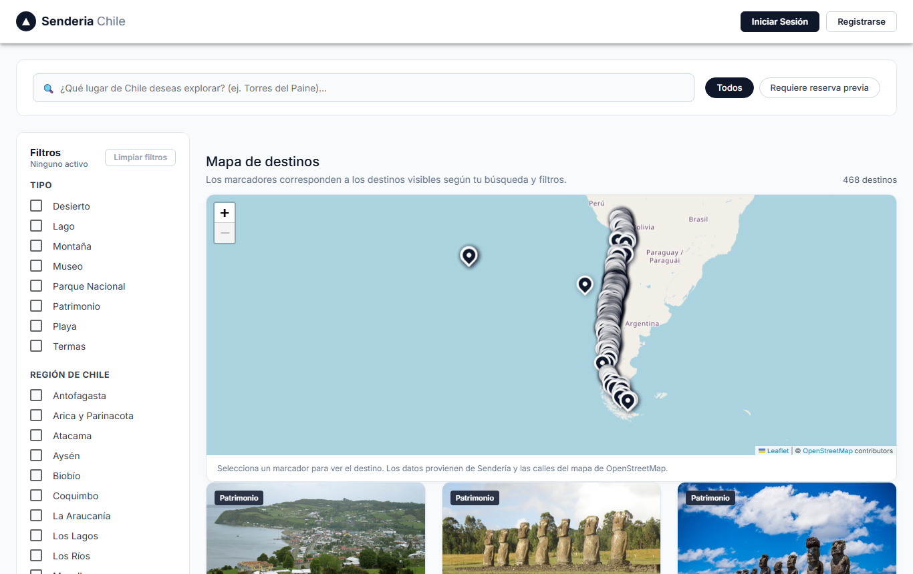
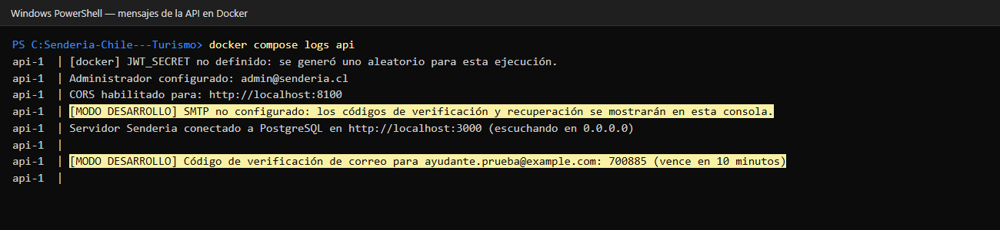
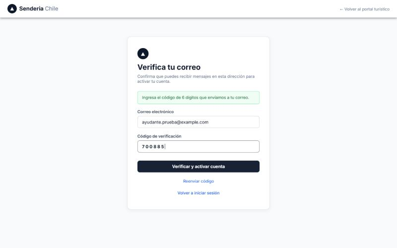

# Evidencia — Despliegue local con Docker (EF6)

**Fecha:** 14 de noviembre de 2026
**Equipo de prueba:** Windows 11 Pro, AMD Ryzen 5 5600GT, Docker Desktop 4.99 (Docker Engine 29.9, Compose 5.7)

## Cómo se hizo la prueba

Para simular lo que hará el profesor o el ayudante, se copiaron a una carpeta nueva **solo los archivos que tendría un clon del repositorio**: sin `node_modules`, sin `.env` y sin datos previos. En esa carpeta se ejecutó:

```bash
docker compose build --no-cache
docker compose up -d
```

- Las imágenes se construyeron desde cero y los tres contenedores quedaron **sanos (healthy)** en **107 segundos**.
- No se configuró ninguna variable: todo funcionó con los valores por defecto.

## Resultados

| Comprobación | Resultado |
|---|---|
| Contenedores `db`, `api` y `web` | ✅ Los tres en estado *healthy* |
| Carga automática de la base | ✅ 16 regiones, 8 categorías, 484 destinos (478 de SERNATUR) |
| Cuenta administradora | ✅ Creada sola al iniciar (`admin@senderia.cl`) |
| API (`/api/health`) | ✅ `status: ok`, `database: connected` |
| Frontend en `http://localhost:8100` | ✅ Mapa y catálogo cargados, sin errores en la consola del navegador |
| CORS | ✅ Solo acepta `http://localhost:8100` |
| Registro sin Gmail configurado | ✅ El código aparece en `docker compose logs api` |
| Verificación de la cuenta desde la app | ✅ Con el código de los logs, la cuenta se activa e inicia sesión |
| Login de administrador | ✅ |

## Capturas

### 1. Contenedores en ejecución y base de datos cargada



### 2. Aplicación servida por Docker



### 3. Código de verificación en los mensajes de la API (modo desarrollo)



### 4. Verificación de la cuenta con ese código


